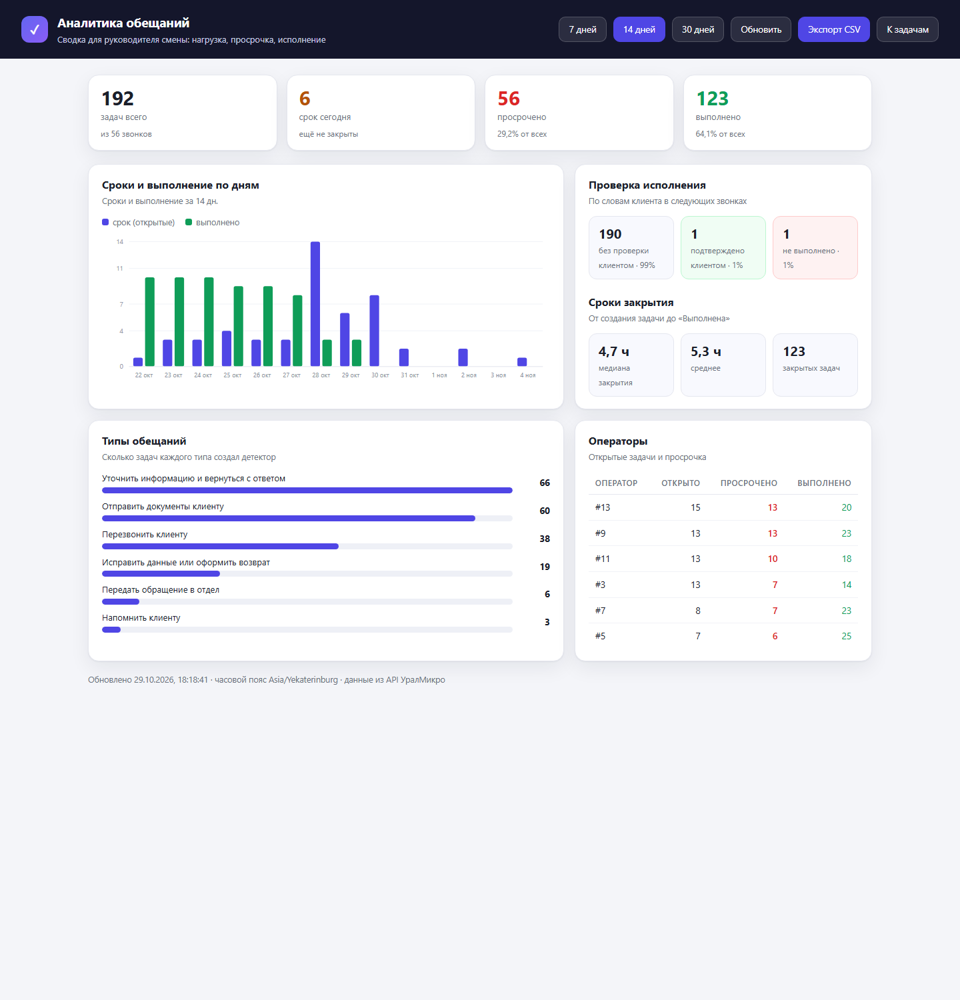

# Сервис контроля обещаний

<p>
  
  
  
  
  
</p>

**Сервис контроля обещаний** — прототип для кейса **УралМикро** (хакатон 2026).
Принимает расшифровки звонков контакт-центра, находит в репликах оператора обещания
(«перезвоню», «вышлю счёт», «уточню и вернусь с ответом»), превращает каждое в задачу
со сроком и ведёт её до выполнения — а потом проверяет по следующим звонкам,
выполнил ли оператор обещанное.

```
звонки (POST /webhook/calls) → поиск обещаний → задачи со сроком → статусы и просрочка
                                         ↑
                        проверка по следующим звонкам клиента
```

<p>
  
</p>

**Сделано:** работающий API минимального уровня + панель оператора + проверка исполнения
по следующим звонкам + аналитика и выгрузка. **88 тестов**, 15 методов API.
На 52 расшифровках из API партнёра: **189 задач**, в среднем **3,6 обещания на звонок**.

<b>Быстрый старт</b> · <a href="#api">API</a> · <a href="#как-работает-поиск-обещаний">Как это работает</a> ·
<a href="docs/ARCHITECTURE.md">Архитектура</a> · <a href="#тесты">Тесты</a> · <a href="#ограничения-решения">Ограничения</a>

<details>
<summary>Содержание</summary>

- [Быстрый старт на Windows](#быстрый-старт-на-windows)
- [Сотрудники, вход и взятие задач](#сотрудники-вход-и-взятие-задач)
- [Уведомления: сайт и почта](#уведомления-сайт-и-почта)
- [Публичный стенд на бесплатном хостинге](#публичный-стенд-на-бесплатном-хостинге)
- [Как работает поиск обещаний](#как-работает-поиск-обещаний)
- [API](#api)
- [Сроки и статусы](#сроки-и-статусы)
- [Проверка исполнения по следующим звонкам](#проверка-исполнения-по-следующим-звонкам)
- [Аналитика и выгрузка](#аналитика-и-выгрузка)
- [Тесты](#тесты)
- [Презентация на защиту](#презентация-на-защиту)
- [Структура проекта](#структура-проекта)
- [Ограничения решения](#ограничения-решения)
- [Использованные ИИ-инструменты](#использованные-ии-инструменты)
- [Команда и кейс](#команда-и-кейс)

</details>

---

## Быстрый старт на Windows

Нужен Python 3.11+ (проверено на 3.13).

```powershell
# 1. Перейти в папку проекта
cd promise-control

# 2. Создать окружение и поставить зависимости
python -m venv .venv
.\.venv\Scripts\Activate.ps1
pip install -r requirements.txt

# 3. Запустить сервис
python -m uvicorn app.main:app --host 127.0.0.1 --port 8080
```

Или одной командой: `.\run.ps1`

Открыть:

| Что | Адрес |
|---|---|
| Веб-панель оператора | http://localhost:8080/ |
| Swagger (все методы) | http://localhost:8080/docs |
| Проверка живости | http://localhost:8080/health |
| Вебхук для звонков | http://localhost:8080/webhook/calls |

Если PowerShell не разрешает `Activate.ps1`:
`Set-ExecutionPolicy -Scope Process -ExecutionPolicy Bypass`

### Демонстрационные данные

```powershell
python scripts\seed_demo.py     # загрузит 52 звонка из data/sample_calls.json
```

### Запуск с программой-отправителем

```powershell
# service_token выдаётся при создании команды: POST https://utmn-api.uralmicro.ru/api/v1/teams
.\sender_windows_amd64.exe -t <service_token> -w http://localhost:8080/webhook/calls
```

Сервис принимает массив из 10 звонков, отвечает сводкой и не создаёт дублей при повторной отправке.

---

## Сотрудники, вход и взятие задач

Каждый сотрудник работает под своей учётной записью, а задача закрепляется за тем,
кто взял её в работу.

**Сайт закрыт шлюзом.** Панель и аналитика открываются только после входа:
`GET /` и `GET /analytics` без сессии отвечают `303` на `/login?next=<куда шли>`,
после входа браузер возвращает на запрошенную страницу. Анонимный посетитель
не видит ни задач, ни цифр — только форму входа. Прямой доступ к `/static/index.html`
закрыт (ответ `404`), иначе страницу можно было бы открыть в обход шлюза.

**Вход по ссылке на почту — пароля нет.** На `/login` сотрудник вводит рабочую почту,
сервис присылает письмо со ссылкой и кодом на 15 минут. Клик по ссылке — и он в панели;
код нужен, если письмо открыли не в том браузере.

- **Новый сотрудник** заводится сам при первом входе: имя берётся из поля в форме
  или собирается из адреса (`ivan.petrov@` → «Ivan Petrov»).
- **Ссылка одноразовая:** после входа гаснет, новая отменяет предыдущую.
- **Ограничения:** 3 письма за 10 минут на адрес, 5 попыток ввода кода.
- **Почта уникальна и без учёта регистра:** `Anna@Company.ru` = `anna@company.ru`.

Пароль остаётся запасным путём: `/register` (почта, пароль, имя) и вкладка «Пароль» на
странице входа. Пароли — PBKDF2-HMAC-SHA256 с солью, `POST /auth/password` меняет пароль
и закрывает прочие сессии.

Сессия — `HttpOnly`-cookie на 30 дней. Если она истекла, интерфейс сам переводит
на `/login`, а не показывает ошибку `401`. В демо-режиме без SMTP письмо сохраняется
в `data/outbox`, а ссылка показывается прямо на странице входа (блок «Демо-режим»).

**Взятие задачи.** Кнопка «Взять в работу» вызывает `POST /api/v1/tasks/{id}/take`:
статус становится «В работе», задача закрепляется за сотрудником. В карточке появляется
пометка «взял Анна Смирнова», в API — поля `assignee_id`, `assignee_name`, `taken_at`.
Второй сотрудник не может перехватить чужую задачу (ответ `409`), но видит, кто её взял.

Статусы меняет только вошедший сотрудник. Машинный приём звонков
(`POST /webhook/calls`) остаётся доступным без сессии — по нему интегрируется партнёр.
Остальное закрыто: интерфейс шлюзом входа, уведомления — сессией сотрудника.

Бот и мессенджеры не используются: вход только по почте и паролю.

---

## Уведомления: сайт и почта

Сервис сам следит за сроками: раз в минуту проверяет задачи, взятые в работу,
и создаёт уведомление **в интерфейсе** и **письмо на рабочую почту**.

- **Кому:** сотруднику, который взял задачу в работу.
- **Когда:** за **60 минут** до срока (`REMINDER_MINUTES_BEFORE`) и отдельно —
  когда срок уже прошёл (`Срок истёк`).
- **Что внутри:** название обещания, срок в часовом поясе сервиса, фраза из разговора,
  ссылка `/?task=<id>` — она открывает панель и подсвечивает нужную задачу.
- **Без дублей:** уникальный индекс `(employee_id, kind, task_id)` — повторный проход
  планировщика и перезапуск сервиса нового уведомления не создадут.

Колокольчик в панели показывает число непрочитанных, хранит историю и отправляет
на задачу по клику. Если письмо ушло — рядом с уведомлением видно
«письмо отправлено», если почта работает в файловом режиме — «письмо в outbox».

**Почта.** `EMAIL_TRANSPORT`:

| Значение | Что происходит |
|---|---|
| `auto` (по умолчанию) | SMTP, если задан `SMTP_HOST`, иначе файл |
| `smtp` | настоящая отправка через `SMTP_HOST` / `SMTP_PORT` / `SMTP_USER` / `SMTP_PASSWORD` |
| `file` | письмо сохраняется в `data/outbox/*.eml` — открывается любым почтовым клиентом |

Файловый режим нужен, чтобы сервис работал на машине без доступа к внешнему SMTP:
письма всё равно формируются и их можно проверить.

**Как включить настоящую отправку.** Достаточно двух переменных — `SMTP_USER` и
`SMTP_PASSWORD` (пароль приложения, не обычный пароль от ящика): хост, порт и тип
шифрования подставятся по домену адреса — Яндекс, Gmail, Mail.ru, Outlook.
Свой сервер задаётся через `SMTP_HOST`. Кнопка **«Проверить почту»** в панели
уведомлений отправляет письмо и показывает результат: `доставлено` или текст ошибки
(`535 authentication failed` — не включён доступ почтовых программ в ящике).

`EMAIL_REDIRECT_TO` переадресует письма на один адрес — удобно на демо,
когда у сотрудников в базе условные ящики.
`EMAIL_REDIRECT_DOMAINS=example.com,example.org` ограничивает переадресацию этими
доменами: реальные сотрудники получают письма на свои ящики. Пусто — переадресовывать всё.

| Метод | Назначение |
|---|---|
| `GET /api/v1/notifications` | уведомления сотрудника, `unread`, режим почты |
| `POST /api/v1/notifications/read` | отметить прочитанными (все или `{"ids": [1,2]}`) |
| `POST /api/v1/notifications/scan` | проверить сроки и разослать сейчас (для демо) |

---

## Публичный стенд на бесплатном хостинге

GitHub Pages не подойдёт: сервису нужен живой Python-процесс. В репозитории всё готово для бесплатных тарифов.

**Render (один клик, нужен аккаунт GitHub)**

1. Открыть <https://render.com/deploy?repo=https://github.com/jabkamamka/promise-control>
2. Войти через GitHub → **Create Web Service**.
3. Render сам прочитает `render.yaml`: Python 3.12, `uvicorn`, health-check `/health`, `AUTO_SEED=1`.

Первый деплой ~3 минуты. Бесплатный инстанс засыпает через 15 минут без запросов и просыпается за ~30 секунд.

**Hugging Face Spaces (Docker, без карты)**

1. <https://huggingface.co/new-space> → SDK **Docker**, видимость Public.
2. Запушить репозиторий в Space (`git push space main`).
3. В настройках Space указать переменную `PORT=7860` (её ждёт HF).

**Любой Docker-хостинг**

```bash
docker build -t promise-control .
docker run -p 8080:8080 promise-control
# http://localhost:8080  ·  /analytics  ·  /docs
```

**Про данные.** На бесплатных тарифах диск эфемерный: SQLite обнуляется при перезапуске.
Поэтому в `render.yaml` и `Dockerfile` включён `AUTO_SEED=1` — при пустой базе сервис сам
загружает сохранённый снимок звонков из API (`data/sample_calls.json`, 52 звонка → 189 задач).
Для постоянного хранения нужен платный диск или PostgreSQL (см. `docs/ROADMAP.md`).

Локально `AUTO_SEED` выключен — данные попадают только через вебхук от программы-отправителя.

---

## Как работает поиск обещаний

Полное описание — [docs/ARCHITECTURE.md](docs/ARCHITECTURE.md). Коротко:

1. Берутся только реплики **оператора** (обещания клиента игнорируются).
2. Реплика делится на смысловые куски, в каждом ищется глагол обещания в 1-м лице будущего времени
   («перезвоню», «отправлю», «уточню», «передам»). Вопросы, прошедшее время и сослагательное
   наклонение отсекаются.
3. Тип определяется по глаголу, объекту (документ / смс / выезд) и адресату
   (руководитель, склад, логистика). Спорные случаи решает приоритет: важнее то, что клиент увидит сам.
4. Срок ищется отдельным парсером: «завтра до обеда», «в четверг», «через два часа»,
   «в течение трёх рабочих дней», «до конца недели». Если срок не назван — 24 часа.
5. Каждая реплика-обещание → отдельная задача. Повторная обработка того же звонка дублей не создаёт.

Три обязательных типа из кейса встроены: `callback`, `documents`, `clarification`.
Дополнительно: `transfer`, `fix`, `visit`, `notification`. Свой тип добавляется через API.

---

## API

Полное описание с примерами — [docs/API.md](docs/API.md). Краткая таблица:

| Метод | Назначение |
|---|---|
| `POST /webhook/calls` | Приём звонков: массив, один объект или `{"calls": [...]}` |
| `GET /api/v1/tasks` | Задачи с фильтрами: `status`, `type`, `operator_id`, `due_before`, `due_after`, `q`, `sort`, `limit`, `offset` |
| `GET /api/v1/tasks/{id}` | Задача по id |
| `PATCH /api/v1/tasks/{id}` | Смена статуса: `created → in_progress → done` |
| `GET /api/v1/tasks/{id}/events` | История задачи (создание, смены статуса, просрочка) |
| `GET /api/v1/promise-types` | Справочник типов обещаний |
| `POST /api/v1/promise-types` | Добавить свой тип (название, описание, ключевые слова, примеры) |
| `DELETE /api/v1/promise-types/{code}` | Удалить пользовательский тип |
| `GET /api/v1/calls` | Список принятых звонков |
| `GET /api/v1/calls/{id}` | Звонок с расшифровкой и задачами |
| `POST /api/v1/calls/{id}/reanalyze` | Прогнать звонок заново (например, после добавления типа) |
| `GET /api/v1/stats` | Сводка: звонки, задачи, статусы, просрочка, проверка |
| `GET /api/v1/analytics` | Агрегаты для страницы аналитики (`days` = 1…90) |
| `GET /api/v1/tasks-export` | Выгрузка задач в CSV для Excel (те же фильтры) |
| `POST /auth/register` | Регистрация по почте: имя, почта, пароль |
| `POST /auth/email/start` | Прислать ссылку и код для входа (пароль не нужен) |
| `GET /auth/email/verify?token=…` | Вход по ссылке из письма |
| `POST /auth/email/verify` | Вход по коду из письма |
| `POST /auth/login` | Вход по почте и паролю |
| `POST /auth/logout` | Выход |
| `GET /auth/me` | Текущий сотрудник |
| `POST /auth/password` | Смена пароля (нужен вход) |
| `POST /api/v1/tasks/{id}/take` | Взять задачу в работу (нужен вход) |
| `GET /health` | Живость сервиса |

Пример: добавить свой тип обещания

```powershell
curl -X POST http://localhost:8080/api/v1/promise-types `
  -H "Content-Type: application/json" `
  -d '{"title":"Согласовать скидку","description":"Оператор обещает согласовать скидку с руководителем и вернуться с ответом","keywords":["скидк","согласую"],"examples":["Согласую скидку и перезвоню"]}'
```

Пример: взять задачу в работу и закрыть

```powershell
curl -X PATCH http://localhost:8080/api/v1/tasks/tsk_xxxxxxxxxxxx -H "Content-Type: application/json" -d '{"status":"in_progress"}'
curl -X PATCH http://localhost:8080/api/v1/tasks/tsk_xxxxxxxxxxxx -H "Content-Type: application/json" -d '{"status":"done","comment":"Перезвонил клиенту"}'
```

---

## Сроки и статусы

- Срок считается **от окончания звонка** в часовом поясе `APP_TIMEZONE` (по умолчанию `Asia/Yekaterinburg`).
- Если срок не назван — **24 часа** (`deadline_source = default_24h`).
- Статусы: **Создана → В работе → Выполнена**. Просрочка не хранится в поле статуса:
  она вычисляется по сроку (`effective_status = overdue`) и одновременно фиксируется в истории задачи.
- Переходы ограничены: `created → in_progress → done`; вернуть в работу можно из `done`.
  Недопустимый переход — `409 Conflict`.

---

## Проверка исполнения по следующим звонкам

Партнёр просил не просто фиксировать обещание, а проверять, выполнено ли оно. Сервис делает это сам:

1. когда с того же номера приходит более поздний звонок, сервис смотрит реплики клиента;
2. подтверждение («да, мне перезвонили», «счёт пришёл») закрывает задачу и пишет событие `verified`;
3. опровержение («никто не позвонил», «акт так и не пришёл») переводит задачу в статус **Не выполнено**;
4. вопрос, сослагательное наклонение и побуждение («вам перезвонили?») доказательством не считаются.

Фильтр: `GET /api/v1/tasks?verification=confirmed|refuted|pending`. Сводка — поля
`by_verification` и `not_fulfilled` в `/api/v1/stats`.

---

## Аналитика и выгрузка

Отдельная страница для руководителя смены — **http://localhost:8080/analytics**:

- задачи, срок сегодня, просрочка и выполненные с долями;
- график «сроки и выполнение по дням» (окно 14 дней вокруг сегодняшнего);
- проверка исполнения: без проверки / подтверждено / не выполнено;
- медиана и среднее время закрытия задачи;
- разбивка по типам обещаний и таблица операторов;
- кнопка **Экспорт CSV** — файл для Excel (разделитель `;`, BOM, кириллица не ломается).

Данные отдают два новых метода: `GET /api/v1/analytics?days=14` и
`GET /api/v1/tasks-export` (те же фильтры, что у `/api/v1/tasks`).

```powershell
python scripts\seed_demo.py
```

Скрипт загружает сохранённую выборку из `data/sample_calls.json` **без изменений**: те же id,
время, операторы и расшифровки, что отдал API. Живой приём проверяется программой-отправителем
из кейса — `sender_windows_amd64.exe` (см. раздел «Быстрый старт»).

---

## Тесты

```powershell
pip install -r requirements-dev.txt
python -m pytest
```

88 тестов: парсер сроков (28), детектор обещаний (13), API и статусы (16), прогон 52 реальных
расшифровок (3), дополнительная выборка из API на 48 звонков (3), проверка исполнения по
следующим звонкам (13), аналитика и CSV (7), опциональный LLM-режим (5). Тесты не зависят
от текущей даты: проверка исполнения использует даты 2033/2034 года. Покрыты: идемпотентность, фильтры, просрочка,
свои типы, запрещённые переходы.

---

## Презентация на защиту

`docs/Презентация_7_минут.pptx` — 9 слайдов под регламент 7 минут: проблема → решение → демо →
как работает поиск → сроки → надёжность → ограничения → итог. В заметках каждого слайда —
что говорить и сколько времени.

Собрать заново после правок: `python scripts\build_pitch.py`,
проверить на переполнение: `python scripts\check_pitch.py`.

---

## Структура проекта

```
app/
  main.py            сборка FastAPI, статика, CORS
  config.py          настройки из .env
  db.py              схема SQLite, инициализация, справочник типов
  schemas.py         Pydantic-схемы запросов и ответов
  api/               HTTP-слой: calls, tasks, types, system, auth, analytics, notifications
  services/
    taxonomy.py      типы обещаний и лексика (глаголы, объекты, адресаты)
    detect.py        поиск обещаний в репликах оператора
    deadline.py      разбор русского срока в дату/время
    ingest.py        приём звонков, идемпотентность, создание задач
    tasks.py         выборка, статусы, просрочка, статистика
    verify.py        проверка исполнения по следующим звонкам клиента
    analytics.py     агрегаты для страницы аналитики
    export.py        выгрузка задач в CSV
    llm.py           опциональный LLM-режим (по умолчанию выключен)
    auth.py          сотрудники, сессии, вход по ссылке, пароли
    notifications.py уведомления: сроки, интерфейс, письма
    mailer.py        отправка писем (SMTP или файл в data/outbox)
  web/               панель оператора и страница аналитики (HTML + CSS + JS без сборки)
tests/               131 тест
data/sample_calls.json  52 расшифровки из API партнёра (канонический набор)
data/sample_calls_extra.json  48 дополнительных звонков из API (проверка на новых данных)
data/sample_verification.json  4 звонка: две пары для демонстрации проверки исполнения
docs/                API, архитектура, демо-сценарий, бриф, разбор записи, презентация, план работ
scripts/             seed_demo.py, build_pitch.py, check_pitch.py
```

---

## Ограничения решения

Честно и без прикрас:

1. **Поиск основан на правилах и лексике**, а не на полноценной языковой модели. На подготовленных
   данных кейса работает устойчиво, но незнакомые формулировки («созвонюсь», «накапаю ответ»)
   могут не распознаваться. Это осознанный выбор: решение объяснимо, работает без интернета и без
   платных API.
2. **Проверка исполнения работает по правилам, а не по смыслу** — клиент должен явно сказать
   «мне перезвонили» или «счёт так и не пришёл». Иронию, намёки и перенос темы сервис не понимает
   и оставляет задачу открытой (это безопаснее ложного закрытия).
3. **Праздники не учитываются** при расчёте рабочих дней (только суббота и воскресенье).
4. **Формулировки без даты** («за день до срока») получают срок 24 часа по умолчанию.
5. **SQLite и один процесс** — для нагрузки контакт-центра нужен PostgreSQL и очередь; архитектура
   к этому готова, но не реализовано.
6. **Часовой пояс один на сервис** (`APP_TIMEZONE`); в данных кейса у операторов один пояс.
7. **LLM-режим выключен по умолчанию** и не проверялся на реальном ключе в этом окружении.

---

## Использованные ИИ-инструменты

| Инструмент | Для чего | Что проверено вручную |
|---|---|---|
| AutoClaw (LLM-агент) | Генерация кода, тестов, документации; разбор кейса | Архитектура, логика детектора и парсера сроков, прогон тестов, ручная проверка задач |
| faster-whisper (локально, CPU) | Расшифровка аудиозаписи брифинга организаторов | Ключевые тезисы сверены с текстом кейса |
| GitHub API | Создание репозитория и загрузка кода | — |

Ответ ИИ не использовался как доказательство: все цифры в README получены прогоном кода на данных кейса.

---

## Команда и кейс

Кейс: «Сервис контроля обещаний», партнёр — УралМикро, хакатон 2026 (гимназия ТюмГУ).
Данные звонков синтетические, предоставлены организаторами.

---

## Совместная работа

Репозиторий вёлся двумя ИИ-агентами параллельно: первая версия осталась в истории коммитов `main`,
итоговая консолидированная — текущая. Правила для следующего агента/разработчика — [AGENTS.md](AGENTS.md),
бэклог — [docs/ROADMAP.md](docs/ROADMAP.md). Из первой версии взяты: разбор аудиозаписи брифинга
([docs/RECORDING_8.md](docs/RECORDING_8.md)), идея искать срок в следующей реплике оператора
и совместимые адреса API (`POST /calls`, `PATCH /api/v1/tasks/{id}/status`).
